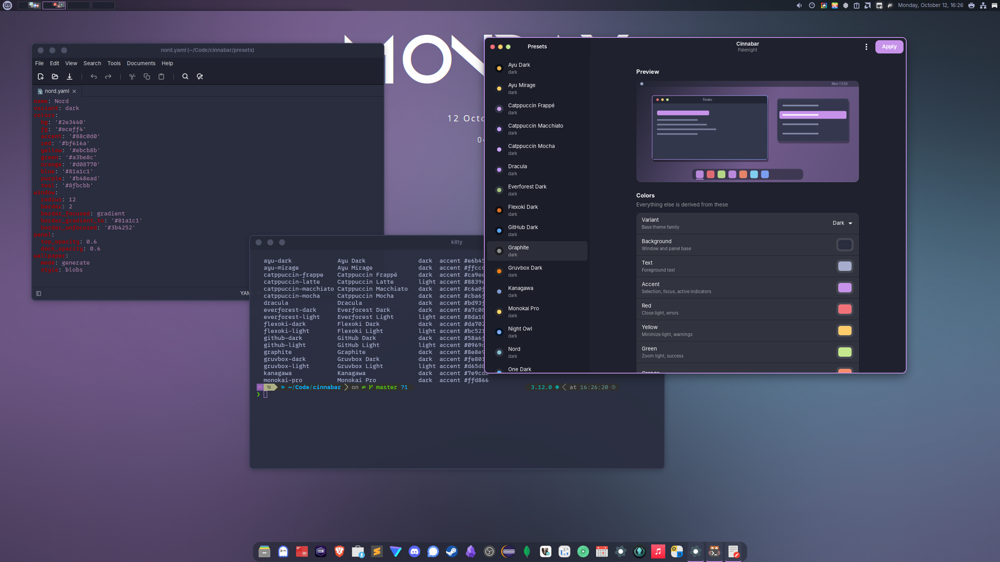
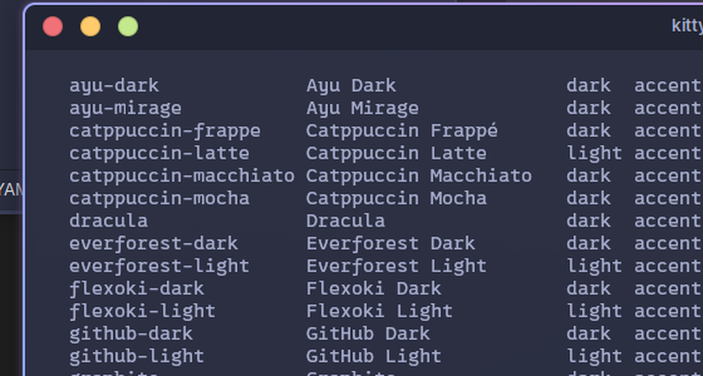
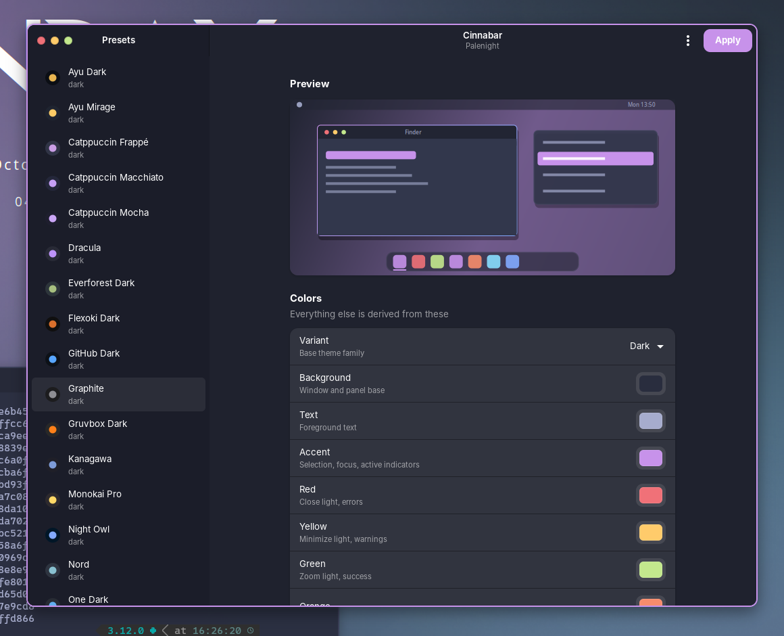
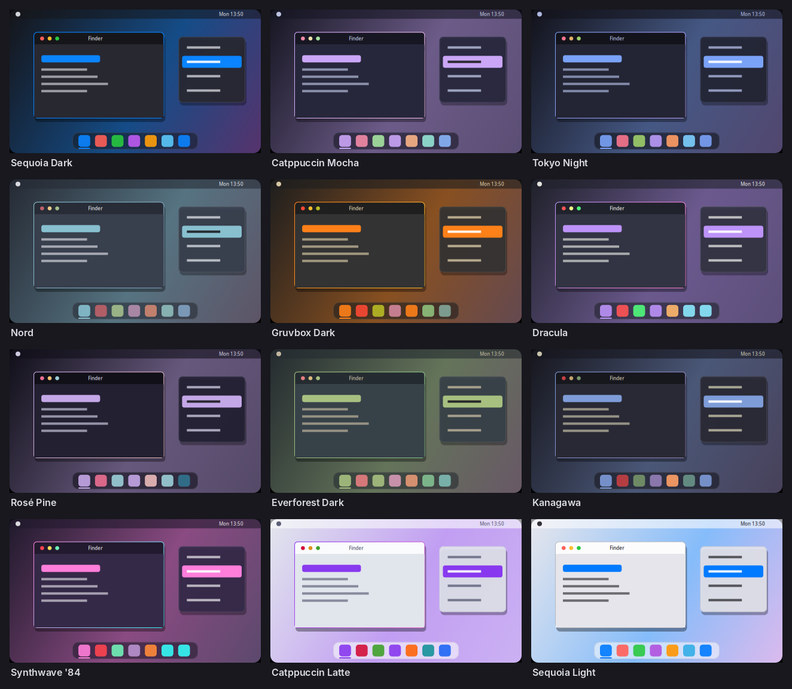

<p align="center"></p>

<p align="center"><b>A token-driven theme engine that makes Linux Mint Cinnamon look as clean as macOS, with Hyprland-style window borders.</b></p>

One small YAML preset (colors, radius, border, fonts, panel geometry) is compiled into a complete,
cohesive desktop: GTK 2/3/4 and libadwaita themes, Muffin window frames, the Cinnamon shell,
rounded corners and animated borders on every window, terminal color schemes, a generated wallpaper
and, optionally, the login screen. 42 presets ship in the box, and there is an app, a CLI and a tray
icon to switch between them.

<p align="center"></p>

## Features

| Area | What you get |
|---|---|
| Windows | macOS traffic lights (left), centered titles, all four corners rounded, a 2px accent border that can be a **rotating two-tone gradient** (Hyprland style), expand/contract open and close animations |
| GTK 2 / 3 / 4, libadwaita | a full theme derived from Mint-Y by remapping every color in CSS, SVG and PNG assets onto the preset palette, plus overrides for radius, headerbars and controls; flatpak apps included |
| Cinnamon shell | translucent top panel, the bottom panel as a floating dock pill with an accent indicator, rounded translucent menus, notifications, OSD, alt-tab; Blur Cinnamon configured automatically |
| Terminals | kitty, Alacritty, Ghostty color schemes (included from their configs) and Terminator's default profile recolored in place |
| Fonts and icons | Inter (installed if missing), your monospace font, any installed icon/cursor theme |
| Wallpaper | generated from the palette (soft color fields or gradient), or any image |
| Login screen | LightDM/slick-greeter: theme, background, fonts and greeter options from the preset, installed system-wide with a backup |
| App, CLI, tray | a libadwaita app with live preview and color pickers, a `cinnabar` CLI, and a panel tray icon to switch presets in two clicks |
| Safety | the desktop settings are snapshotted before the first apply; `cinnabar restore` puts everything back |

<p align="center">&nbsp;</p>

<p align="center"><br><sub>The bottom panel becomes a floating dock. The status area gets a tray icon for switching presets.</sub></p>

## Install

Requirements: Linux Mint 21.2 or newer with Cinnamon 5.8+ on X11 (developed on Mint 22.3 / Cinnamon 6.6).
Everything else is pulled in by the installer: Python GTK bindings (GTK 3, GTK 4, libadwaita, XApp),
PyYAML, Jinja2, Pillow, wmctrl, dconf, libnotify, the Inter font and the Blur Cinnamon extension.

```sh
git clone https://github.com/nullop/cinnabar.git ~/Code/cinnabar
cd ~/Code/cinnabar
./install.sh            # asks for sudo once, for apt
cinnabar apply sequoia-dark
```

The installer

1. installs missing system packages with apt,
2. downloads the Blur Cinnamon extension from Cinnamon Spices if it is not installed,
3. links `cinnabar` into `~/.local/bin` and adds **Cinnabar** and **Cinnabar Tray** to the application menu,
4. enables the tray icon (autostarts at login).

Flags: `--no-apt`, `--no-blur`, `--no-tray`. Nothing is written outside your home except through apt.

### Uninstall / undo

```sh
cinnabar restore        # original desktop settings, Blur Cinnamon settings and flatpak overrides
cinnabar login --restore
rm -rf ~/.themes/Cinnabar ~/.local/bin/cinnabar ~/.local/share/applications/cinnabar*.desktop \
       ~/.config/autostart/cinnabar-tray.desktop ~/.local/share/cinnamon/extensions/CinnabarCorners@cinnabar
```

## Usage

```sh
cinnabar list                    # bundled + user presets (* = currently applied)
cinnabar apply nord              # build ~/.themes/Cinnabar and apply everything
cinnabar apply ~/my-preset.yaml  # any preset file
cinnabar gui                     # the app: presets, color pickers, live preview, Apply
cinnabar tray                    # panel status icon with a preset menu
cinnabar login [preset]          # theme the LightDM login screen (asks for the admin password)
cinnabar wallpaper nord -o x.png # just render the wallpaper
cinnabar restore                 # back to the pre-Cinnabar desktop
```

Re-applying soft-restarts Cinnamon (windows stay open), because GTK caches a theme's CSS per
process and Muffin would otherwise keep the previous build. Apps that were already running keep
their old look until relaunched.

## Presets

<p align="center"></p>

**Dark**

| Preset | `slug` |
|---|---|
| Ayu Dark | `ayu-dark` |
| Ayu Mirage | `ayu-mirage` |
| Catppuccin Frappé | `catppuccin-frappe` |
| Catppuccin Macchiato | `catppuccin-macchiato` |
| Catppuccin Mocha | `catppuccin-mocha` |
| Dracula | `dracula` |
| Everforest Dark | `everforest-dark` |
| Flexoki Dark | `flexoki-dark` |
| GitHub Dark | `github-dark` |
| Graphite | `graphite` |
| Gruvbox Dark | `gruvbox-dark` |
| Kanagawa | `kanagawa` |
| Monokai Pro | `monokai-pro` |
| Night Owl | `night-owl` |
| Nord | `nord` |
| One Dark | `one-dark` |
| Oxocarbon | `oxocarbon` |
| Palenight | `palenight` |
| Rosé Pine Moon | `rose-pine-moon` |
| Rosé Pine | `rose-pine` |
| Sequoia Dark | `sequoia-dark` |
| Sequoia Green | `sequoia-green` |
| Sequoia Midnight | `sequoia-midnight` |
| Sequoia Orange | `sequoia-orange` |
| Sequoia Pink | `sequoia-pink` |
| Sequoia Purple | `sequoia-purple` |
| Sequoia Teal | `sequoia-teal` |
| Solarized Dark | `solarized-dark` |
| Synthwave '84 | `synthwave` |
| Tokyo Night Storm | `tokyo-night-storm` |
| Tokyo Night | `tokyo-night` |
| Vesper | `vesper` |

**Light** (switch to Papirus-Light icons automatically)

| Preset | `slug` |
|---|---|
| Catppuccin Latte | `catppuccin-latte` |
| Everforest Light | `everforest-light` |
| Flexoki Light | `flexoki-light` |
| GitHub Light | `github-light` |
| Gruvbox Light | `gruvbox-light` |
| Rosé Pine Dawn | `rose-pine-dawn` |
| Sequoia Light Purple | `sequoia-light-purple` |
| Sequoia Light | `sequoia-light` |
| Solarized Light | `solarized-light` |
| Tokyo Night Day | `tokyo-night-day` |

## Make your own

Save a YAML file in `~/.config/cinnabar/presets/` (the app's *Save as preset…* does this).
Every key is optional and falls back to `cinnabar/tokens.py:DEFAULTS`.

```yaml
name: My Rice
variant: dark                      # picks the Mint-Y base (dark | light)
colors:
  bg: "#1e1e2e"
  fg: "#cdd6f4"
  accent: "#cba6f7"
  red: "#f38ba8"                   # close light, errors
  yellow: "#f9e2af"                # minimize light, warnings
  green: "#a6e3a1"                 # zoom light, success
  orange: "#fab387"
  blue: "#89b4fa"
  purple: "#cba6f7"
  teal: "#94e2d5"
window:
  radius: 10
  border: 2
  border_focused: gradient         # accent | gradient | "#hex"
  border_gradient_to: "#f5c2e7"
  border_unfocused: "#313244"
  border_animate: true             # rotate the gradient around the focused window
  border_speed: 8                  # seconds per turn
  effects: true                    # expand on open / contract on close
  effect_duration: 220
  effect_scale: 80
  buttons: left                    # left (macOS) | right
  titlebar_height: 36
controls: { radius: 6, popup_radius: 12 }
panel:
  top_height: 28
  top_opacity: 0.6
  dock: true
  dock_height: 52
  dock_icon_size: 36
  dock_opacity: 0.6
  dock_radius: 18
  blur: true
fonts: { ui: "Inter 10", title: "Inter Semi-Bold 10", mono: "JetBrainsMono Nerd Font 11" }
icons: Papirus-Dark
cursor: { theme: Bibata-Modern-Classic, size: 24 }
wallpaper: { mode: generate, style: blobs }   # generate | keep | file
terminals: { kitty: true, alacritty: true, ghostty: true, terminator: true }
login:
  enabled: false                   # set true to theme the login screen on every apply
  background: desktop              # desktop | generate | file | color
```

## How it works

* `cinnabar/recolor.py` classifies every color literal in the Mint-Y base theme (neutral, accent,
  red/orange/yellow/green/teal/blue/purple) and re-targets it onto the preset palette while keeping
  the base theme's lightness structure. The same mapping runs over CSS, SVG and PNG assets, so the
  result is a complete theme rather than a pile of overrides.
* `templates/*.j2` add the macOS/Hyprland layer: Muffin on Cinnamon ≥ 5.4 draws window frames with
  the GTK theme (`.ssd decoration`, `headerbar.default-decoration`, `button.titlebutton`), the
  Cinnamon shell gets panels, the dock pill, menus and notifications, GTK 4 gets `window.csd`.
* `extension/CinnabarCorners@cinnabar` is a Cinnamon extension with a fragment shader on each
  window's surface actor. It rounds all four corners (Muffin on X11 can only round the top of
  server-side frames), paints the border ring with an optional rotating gradient, and provides the
  expand/contract open and close animations by hooking Cinnamon's map and close handlers.
* `cinnabar/apply.py` snapshots dconf to `~/.config/cinnabar/backup-original-*.dconf` before
  touching anything, then sets gsettings, configures Blur Cinnamon and the extension, adds flatpak
  overrides, writes terminal schemes and the wallpaper.
* `cinnabar/login.py` stages the theme, a background and a greeter config, and a tiny root helper
  installs them to `/usr/share` and `/etc/lightdm/slick-greeter.conf` (backed up once).

## Troubleshooting

* **A window still has its old look** → it was running before the apply; relaunch it (GTK caches CSS per process).
* **No translucency / blur** → the Blur Cinnamon extension is missing; `./install.sh` fetches it, or install it from *Extensions → Download*.
* **Corners or border missing on one app** → `cinnabar` skips maximized, tiled, fullscreen and GTK client-side-decorated windows on purpose. Anything else: open an issue with the app name.
* **Login screen unchanged** → run `cinnabar login` from a terminal to see the helper's output; preview with `slick-greeter --test-mode`.
* **Something looks broken** → `cinnabar restore`, then `cinnabar apply <preset>` again.

## License

MIT. Base theme assets derive from [Mint-Y](https://github.com/linuxmint/mint-themes) (GPL); the
corner-coverage shader math is adapted from Blur my Shell / rounded-window-corners (GPL).
